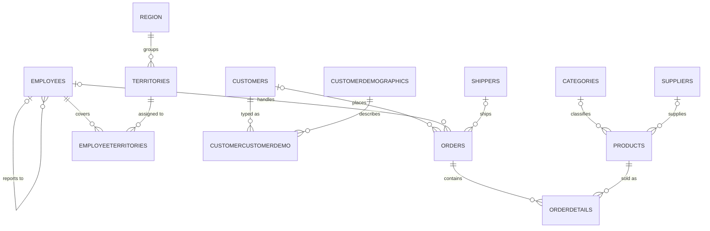

# Northwind for IBM Db2 for i

This repository holds the classic **Northwind Traders** sample database, ported to **IBM Db2 for i** (IBM i 7.5). Northwind models a small import/export food distributor. Its data covers customers, orders and line items, products, suppliers and categories, shippers, and employees with their sales territories.

Use it for demos, training, SQL and query tuning practice, or as a test database for applications that run on IBM i.

> The script creates **structure only**: the schema, tables, constraints, indexes, views and procedures. It does not load any data. See [Loading data](#loading-data).

## Repository contents

| File | Description |
|---|---|
| [`create-northwind-schema.sql`](./create-northwind-schema.sql) | DDL for the whole `NORTHWIND` schema. Generated with IBM i *Generate SQL* (V7R5M0) from system `I75GOLD` |
| [`SCHEMA.md`](./SCHEMA.md) | Schema reference: ER diagram, column-level data dictionary, views, procedures, indexes and constraints |
| `README.md` | This file |

## What's in the schema

| Kind | Count | Objects |
|---|---|---|
| Tables | 14 | `CUSTOMERS`, `CUSTOMERDEMOGRAPHICS`, `CUSTOMERCUSTOMERDEMO`, `EMPLOYEES`, `REGION`, `TERRITORIES`, `EMPLOYEETERRITORIES`, `SHIPPERS`, `ORDERS`, `ORDERDETAILS`, `CATEGORIES`, `SUPPLIERS`, `PRODUCTS`, `AGENTGUIDANCE` |
| Views | 14 | `INVOICES`, `ORDERSUBTOTALS`, `ORDERDETAILSEXTENDED`, `PRODUCTSALESBYYEAR`, `SALESBYCATEGORYANDYEAR`, `QUARTERLYORDERS`, and others |
| Procedures | 3 | `EMPLOYEE_SALES_BY_COUNTRY`, `SALESBYYEAR`, `TEN_MOST_EXPENSIVE_PRODUCTS` |
| Indexes | 23 | Secondary indexes on names, postal codes, dates and foreign keys |



The full diagram, with key columns and every table's columns, is in [`SCHEMA.md`](./SCHEMA.md).

## Requirements

- IBM i **7.5** or later. The script was generated on V7R5M0, and earlier releases may reject some clauses.
- A user profile that can create a schema (library), for example one with `*ALLOBJ` authority or a security officer–delegated profile.
- One of the following ways to run SQL:
  - IBM i Access Client Solutions (ACS), using *Run SQL Scripts*;
  - VS Code with the Code for IBM i and Db2 for i extensions;
  - a 5250 session, using `RUNSQLSTM`.
- The library name `NORTHWIND` must not already exist.

## Installation

### Option 1: ACS Run SQL Scripts

1. Open **ACS → Run SQL Scripts** and connect to your system.
2. Open `create-northwind-schema.sql`.
3. Choose **Run → All**.
4. Check the message pane. Warnings are expected; errors are not.

### Option 2: RUNSQLSTM from a 5250 session

Copy the script to the IFS, for example with `scp` or by mapping a drive:

```bash
scp create-northwind-schema.sql myuser@myibmi:/home/myuser/
```

Then run it:

```
RUNSQLSTM SRCSTMF('/home/myuser/create-northwind-schema.sql')
          COMMIT(*NONE)
          NAMING(*SQL)
          ERRLVL(20)
```

Review the spooled listing (`WRKSPLF`) for any statement that failed.

### Verify the install

```sql
SELECT TABLE_NAME, TABLE_TYPE, SYSTEM_TABLE_NAME
  FROM QSYS2.SYSTABLES
 WHERE TABLE_SCHEMA = 'NORTHWIND'
 ORDER BY TABLE_TYPE, TABLE_NAME;
```

The query should list 14 tables (type `T`) and 14 views (type `V`). To list the procedures:

```sql
SELECT ROUTINE_NAME
  FROM QSYS2.SYSROUTINES
 WHERE ROUTINE_SCHEMA = 'NORTHWIND';
```

### Remove the schema

```sql
DROP SCHEMA NORTHWIND CASCADE;
```

This deletes the library and **everything in it**.

## Loading data

This repo does not include data yet. When you add a data script (for example `data/load-northwind-data.sql`), keep the following in mind:

- **Insert in foreign-key order:** `REGION` → `TERRITORIES` → `EMPLOYEES` → `EMPLOYEETERRITORIES` → `CUSTOMERDEMOGRAPHICS` → `CUSTOMERS` → `CUSTOMERCUSTOMERDEMO` → `SHIPPERS` → `CATEGORIES` → `SUPPLIERS` → `PRODUCTS` → `ORDERS` → `ORDERDETAILS`.
- **Identity columns.** `SHIPPERS`, `ORDERS`, `CATEGORIES`, `SUPPLIERS` and `PRODUCTS` use `GENERATED ALWAYS AS IDENTITY`. To load the original Northwind IDs, use `INSERT ... OVERRIDING SYSTEM VALUE`, then reset each counter:
  ```sql
  ALTER TABLE NORTHWIND.ORDERS ALTER COLUMN ORDERID RESTART WITH 11078;
  ```
- **EBCDIC.** Character columns are CCSID 37, so names with accented characters outside that code page (several Northwind customers are European) can be substituted. Use CCSID 1208 (UTF-8) or 1200 in a fork if you need full Unicode.
- **`EMPLOYEES.EMPLOYEEID`** is not an identity column, so supply the value on insert. Insert managers before the employees who report to them.

## Usage examples

```sql
-- Revenue by year
SELECT YEAR(o.SHIPPEDDATE) AS YR, SUM(s.SUBTOTAL) AS REVENUE
  FROM NORTHWIND.ORDERS o
  JOIN NORTHWIND.ORDERSUBTOTALS s ON s.ORDERID = o.ORDERID
 WHERE o.SHIPPEDDATE IS NOT NULL
 GROUP BY YEAR(o.SHIPPEDDATE)
 ORDER BY YR;

-- Products at or below their reorder level
SELECT PRODUCTNAME, UNITSINSTOCK, REORDERLEVEL
  FROM NORTHWIND.PRODUCTS
 WHERE DISCONTINUED = 0 AND UNITSINSTOCK <= REORDERLEVEL;

-- Stored procedures
CALL NORTHWIND.TEN_MOST_EXPENSIVE_PRODUCTS();
CALL NORTHWIND.EMPLOYEE_SALES_BY_COUNTRY('1997-01-01-00.00.00', '1997-12-31-23.59.59');
```

## Conventions

- **Naming.** SQL names are upper case without underscores (`ORDERDETAILS`, `UNITPRICE`). Objects and columns longer than 10 characters have fixed short **system names** for native access. For example, the `ORDERDETAILS` table is file `ORDERDTLS`. The mapping is in [`SCHEMA.md`](./SCHEMA.md#long-names-vs-system-names).
- **Booleans** are `SMALLINT` with `0` for false and `1` for true (`PRODUCTS.DISCONTINUED`, `AGENTGUIDANCE."GLOBAL"`).
- **Money** is `DECIMAL(19,4)`.
- **Discounts** are `REAL` fractions between 0 and 1.
- **Referential actions** are all `NO ACTION`, so delete child rows before their parents.
- **Reserved words.** `"GLOBAL"` (in `AGENTGUIDANCE`) and `"YEAR"` (in `QUARTERLYORDERS`) must be quoted in SQL.

## Known issues and notes

- **Object order.** The procedures `EMPLOYEE_SALES_BY_COUNTRY` and `SALESBYYEAR` reference the view `ORDERSUBTOTALS`, but the script creates that view afterward. Db2 for i usually accepts this with a warning and resolves the view at run time. If your run reports an error, move the `CREATE VIEW NORTHWIND.ORDERSUBTOTALS` block above the procedures.
- **Duplicate indexes.** Six pairs of indexes cover identical columns (for example `IDX_CUSTOMERID` and `IDX_CUSTOMERSORDERS`). These pairs were inherited from the original Northwind and are safe to consolidate.
- **No rounding in extended price.** The views compute extended price as `... / 100 * 100`, which keeps four decimal places rather than rounding to cents.
- **Broad PUBLIC authority.** `PUBLIC` is granted `CREATEIN` on the schema and `INSERT`/`UPDATE`/`DELETE` on the tables. That is fine for a sandbox. Tighten these grants before you use the schema on a shared or production system.
- **Write grants on read-only views.** The script grants write privileges on `CURRENTPRODUCTLIST` and `PRODUCTSABOVEAVERAGEPRICE`. The second view contains a subquery and cannot be updated.
- **`AGENTGUIDANCE`** is a local addition that isn't part of standard Northwind. Unlike the other tables, it has no system-name clauses and no explicit CCSIDs.

## Contributing

1. Make schema changes in `create-northwind-schema.sql`, or add numbered migration scripts such as `migrations/001-add-xyz.sql`.
2. Update [`SCHEMA.md`](./SCHEMA.md) in the same commit.
3. Test the full script on a clean system with `DROP SCHEMA NORTHWIND CASCADE`, then a re-run.

## Credits

Northwind was originally a Microsoft sample database for Access and SQL Server. This repository contains a port of its schema to Db2 for i.
