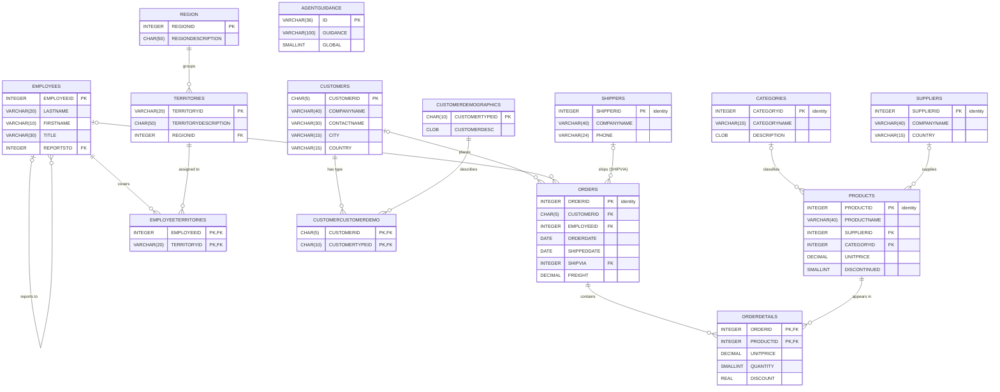

# NORTHWIND Schema Reference

Data dictionary for the `NORTHWIND` schema on **IBM Db2 for i** (generated from `I75GOLD`, IBM i V7R5M0).
Source of truth: [`create-northwind-schema.sql`](./create-northwind-schema.sql).

Contents:

1. [Entity-relationship diagram](#entity-relationship-diagram)
2. [Tables](#tables)
3. [Views](#views)
4. [Stored procedures](#stored-procedures)
5. [Indexes](#indexes)
6. [Constraints summary](#constraints-summary)
7. [Long names vs. system names](#long-names-vs-system-names)

---

## Entity-relationship diagram



`AGENTGUIDANCE` has no relationships to the other tables.

---

## Tables

Conventions used below:

- **System name** is the 10-character IBM i object or field name, listed only where it differs from the SQL name.
- **Null?** `N` means `NOT NULL`. A blank means the column is nullable, with a `NULL` default unless stated.
- All character columns use **CCSID 37** (US/Canada EBCDIC), except in `AGENTGUIDANCE`, which uses the job default.
- `CLOB` columns are `CLOB(1048576)`, which is 1 MB.

### CUSTOMERS

Customer companies that place orders. Record format: `CUSTOMERS`.

| Column | System name | Type | Null? | Default | Notes |
|---|---|---|---|---|---|
| CUSTOMERID | | CHAR(5) | N | | **PK** (`PK_CUSTOMERS`), mnemonic code e.g. `ALFKI` |
| COMPANYNAME | COMPA00001 | VARCHAR(40) | N | | Indexed |
| CONTACTNAME | CONTA00001 | VARCHAR(30) | | | |
| CONTACTTITLE | CONTA00002 | VARCHAR(30) | | | |
| ADDRESS | | VARCHAR(60) | | | |
| CITY | | VARCHAR(15) | | | Indexed |
| REGION | | VARCHAR(15) | | | Indexed. State or province, not a FK to `REGION` |
| POSTALCODE | | VARCHAR(10) | | | Indexed |
| COUNTRY | | VARCHAR(15) | | | |
| PHONE | | VARCHAR(24) | | | |
| FAX | | VARCHAR(24) | | | |

### CUSTOMERDEMOGRAPHICS

Customer type codes and their descriptions. System name: `CUSTDEMOG`. Record format: `CUSTO00003`.

| Column | System name | Type | Null? | Default | Notes |
|---|---|---|---|---|---|
| CUSTOMERTYPEID | CUSTO00001 | CHAR(10) | N | | **PK** |
| CUSTOMERDESC | CUSTO00002 | CLOB(1M) | | | |

### CUSTOMERCUSTOMERDEMO

Junction table that links customers to demographic types (many-to-many). System name: `CUSTCDEMO`. Record format: `CUSTO00002`.

| Column | System name | Type | Null? | Notes |
|---|---|---|---|---|
| CUSTOMERID | | CHAR(5) | N | **PK** part 1. **FK** to `CUSTOMERS` |
| CUSTOMERTYPEID | CUSTO00001 | CHAR(10) | N | **PK** part 2. **FK** to `CUSTOMERDEMOGRAPHICS` |

### EMPLOYEES

Sales staff, with a self-referencing reporting hierarchy. Record format: `EMPLOYEES`.

| Column | System name | Type | Null? | Default | Notes |
|---|---|---|---|---|---|
| EMPLOYEEID | | INTEGER | N | | **PK** (`PK_EMPLOYEES`). Not an identity column, so supply the value on insert |
| LASTNAME | | VARCHAR(20) | N | | Indexed |
| FIRSTNAME | | VARCHAR(10) | N | | |
| TITLE | | VARCHAR(30) | | | |
| TITLEOFCOURTESY | TITLE00001 | VARCHAR(25) | | | e.g. `Ms.`, `Dr.` |
| BIRTHDATE | | DATE | | | |
| HIREDATE | | DATE | | | |
| ADDRESS | | VARCHAR(60) | | | |
| CITY | | VARCHAR(15) | | | |
| REGION | | VARCHAR(15) | | | |
| POSTALCODE | | VARCHAR(10) | | | Indexed (`IDX_POSTALCODE`) |
| COUNTRY | | VARCHAR(15) | | | |
| HOMEPHONE | | VARCHAR(24) | | | |
| EXTENSION | | VARCHAR(4) | | | |
| NOTES | | CLOB(1M) | | | |
| REPORTSTO | | INTEGER | | | **FK** to `EMPLOYEES.EMPLOYEEID` (manager) |

### REGION

Sales regions. Record format: `REGION`.

| Column | System name | Type | Null? | Notes |
|---|---|---|---|---|
| REGIONID | | INTEGER | N | **PK** |
| REGIONDESCRIPTION | REGIO00001 | CHAR(50) | N | Fixed-length, so values are blank-padded |

### TERRITORIES

Sales territories within regions. System name: `TERRITORS`. Record format: `TERRI00001`.

| Column | System name | Type | Null? | Notes |
|---|---|---|---|---|
| TERRITORYID | TERRI00001 | VARCHAR(20) | N | **PK** |
| TERRITORYDESCRIPTION | TERRI00002 | CHAR(50) | N | Fixed-length, so values are blank-padded |
| REGIONID | | INTEGER | N | **FK** to `REGION` |

### EMPLOYEETERRITORIES

Junction table that links employees to territories (many-to-many). System name: `EMPLTERR`. Record format: `EMPLO00001`.

| Column | System name | Type | Null? | Notes |
|---|---|---|---|---|
| EMPLOYEEID | | INTEGER | N | **PK** part 1. **FK** to `EMPLOYEES` |
| TERRITORYID | TERRI00001 | VARCHAR(20) | N | **PK** part 2. **FK** to `TERRITORIES` |

### SHIPPERS

Freight carriers. Record format: `SHIPPERS`.

| Column | System name | Type | Null? | Notes |
|---|---|---|---|---|
| SHIPPERID | | INTEGER | N | **PK**. `GENERATED ALWAYS AS IDENTITY` (start 1, increment 1, cache 20) |
| COMPANYNAME | COMPA00001 | VARCHAR(40) | N | |
| PHONE | | VARCHAR(24) | | |

### ORDERS

Order headers. Record format: `ORDERS`.

| Column | System name | Type | Null? | Default | Notes |
|---|---|---|---|---|---|
| ORDERID | | INTEGER | N | | **PK**. `GENERATED ALWAYS AS IDENTITY` |
| CUSTOMERID | | CHAR(5) | | | **FK** to `CUSTOMERS` |
| EMPLOYEEID | | INTEGER | | | **FK** to `EMPLOYEES` (salesperson) |
| ORDERDATE | | DATE | | | Indexed |
| REQUIREDDATE | REQUI00001 | DATE | | | |
| SHIPPEDDATE | SHIPP00001 | DATE | | | `NULL` means not yet shipped |
| SHIPVIA | | INTEGER | | | **FK** to `SHIPPERS.SHIPPERID` |
| FREIGHT | | DECIMAL(19,4) | | `0` | |
| SHIPNAME | | VARCHAR(40) | | | Ship-to name, which can differ from the customer |
| SHIPADDRESS | SHIPA00001 | VARCHAR(60) | | | |
| SHIPCITY | | VARCHAR(15) | | | |
| SHIPREGION | | VARCHAR(15) | | | |
| SHIPPOSTALCODE | SHIPP00002 | VARCHAR(10) | | | |
| SHIPCOUNTRY | SHIPC00001 | VARCHAR(15) | | | |

### ORDERDETAILS

Order line items. System name: `ORDERDTLS`. Record format: `ORDER00001`.

| Column | Type | Null? | Default | Notes |
|---|---|---|---|---|
| ORDERID | INTEGER | N | | **PK** part 1. **FK** to `ORDERS` |
| PRODUCTID | INTEGER | N | | **PK** part 2. **FK** to `PRODUCTS` |
| UNITPRICE | DECIMAL(19,4) | N | `0` | Price at the time of sale. Check: `>= 0` |
| QUANTITY | SMALLINT | N | `1` | Check: `> 0` |
| DISCOUNT | REAL | N | `0` | A fraction (0.15 = 15%). Check: `0 <= DISCOUNT <= 1` |

### CATEGORIES

Product categories. Record format: `CATEGORIES`.

| Column | System name | Type | Null? | Notes |
|---|---|---|---|---|
| CATEGORYID | | INTEGER | N | **PK**. `GENERATED ALWAYS AS IDENTITY` |
| CATEGORYNAME | CATEG00001 | VARCHAR(15) | N | Indexed |
| DESCRIPTION | DESCR00001 | CLOB(1M) | | |

### SUPPLIERS

Product vendors. Record format: `SUPPLIERS`.

| Column | System name | Type | Null? | Notes |
|---|---|---|---|---|
| SUPPLIERID | | INTEGER | N | **PK**. `GENERATED ALWAYS AS IDENTITY` |
| COMPANYNAME | COMPA00001 | VARCHAR(40) | N | Indexed |
| CONTACTNAME | CONTA00001 | VARCHAR(30) | | |
| CONTACTTITLE | CONTA00002 | VARCHAR(30) | | |
| ADDRESS | | VARCHAR(60) | | |
| CITY | | VARCHAR(15) | | |
| REGION | | VARCHAR(15) | | |
| POSTALCODE | | VARCHAR(10) | | Indexed |
| COUNTRY | | VARCHAR(15) | | |
| PHONE | | VARCHAR(24) | | |
| FAX | | VARCHAR(24) | | |
| HOMEPAGE | | CLOB(1M) | | |

### PRODUCTS

Product catalog and stock levels. Record format: `PRODUCTS`.

| Column | System name | Type | Null? | Default | Notes |
|---|---|---|---|---|---|
| PRODUCTID | | INTEGER | N | | **PK**. `GENERATED ALWAYS AS IDENTITY` |
| PRODUCTNAME | PRODU00001 | VARCHAR(40) | N | | Indexed |
| SUPPLIERID | | INTEGER | | | **FK** to `SUPPLIERS` |
| CATEGORYID | | INTEGER | | | **FK** to `CATEGORIES` |
| QUANTITYPERUNIT | QUANT00001 | VARCHAR(20) | | | Free text, e.g. `10 boxes x 20 bags` |
| UNITPRICE | | DECIMAL(19,4) | | `0` | Current list price. Check: `>= 0` |
| UNITSINSTOCK | UNITS00001 | SMALLINT | | `0` | Check: `>= 0` |
| UNITSONORDER | UNITS00002 | SMALLINT | | `0` | Check: `>= 0` |
| REORDERLEVEL | REORD00001 | SMALLINT | | `0` | Check: `>= 0` |
| DISCONTINUED | DISCO00001 | SMALLINT | N | `0` | Boolean flag: `0` = active, `1` = discontinued |

### AGENTGUIDANCE

This table is an addition; it isn't part of the classic Northwind model. It appears to store short guidance strings for an application or agent, with a flag marking an entry as global. It has no system-name aliases, no CCSIDs, and no record format clause.

| Column | Type | Null? | Default | Notes |
|---|---|---|---|---|
| ID | VARCHAR(36) | N | | **PK** (system-generated constraint name). Sized for a UUID string |
| GUIDANCE | VARCHAR(100) | N | `' '` | |
| "GLOBAL" | SMALLINT | N | `0` | Boolean flag. **Reserved word**: always quote it as `"GLOBAL"` |

---

## Views

Views are listed in dependency order where one view builds on another.

| View | System name | Based on | Purpose |
|---|---|---|---|
| CURRENTPRODUCTLIST | CURPRDLIST | PRODUCTS | ID and name of active products (`DISCONTINUED = 0`) |
| ALPHABETICALLISTOFPRODUCTS | PRODALPHA | PRODUCTS, CATEGORIES | Active products with their category name. Has no `ORDER BY`, so sort in your query |
| PRODUCTSBYCATEGORY | PRODBYCAT | PRODUCTS, CATEGORIES | Category, product, pack size and stock for non-discontinued products |
| PRODUCTSABOVEAVERAGEPRICE | PRODABAVGP | PRODUCTS | Products priced above the average `UNITPRICE` |
| CUSTOMERANDSUPPLIERSBYCITY | CUSSUPBCTY | CUSTOMERS ∪ SUPPLIERS | City, company and contact, tagged `'Customers'` or `'Suppliers'` in `RELATIONSHIP` |
| ORDERSQRY | ORDERSQRY | ORDERS, CUSTOMERS | Orders joined to customer address |
| ORDERSQUERY | ORDER00001 | ORDERS, CUSTOMERS | Same definition as `ORDERSQRY` |
| QUARTERLYORDERS | QTRLYORDS | ORDERS ⟕ CUSTOMERS | Distinct customer, quarter, year and order date. Uses a right join, so orders without a customer are kept |
| ORDERDETAILSEXTENDED | ORDERDTLSE | ORDERDETAILS, PRODUCTS | Line items with product name and `EXTENDEDPRICE` = price × qty × (1 − discount) |
| ORDERSUBTOTALS | ORDSUBTOT | ORDERDETAILS | `SUBTOTAL` per `ORDERID`, summed from extended prices |
| INVOICES | INVOICES | ORDERS, ORDERDETAILS, CUSTOMERS, EMPLOYEES, PRODUCTS, SHIPPERS | One row per invoice line, with ship-to details, salesperson, shipper, extended price and freight |
| PRODUCTSALESBYYEAR | PRODU00001 | CATEGORIES, PRODUCTS, ORDERS, ORDERDETAILS | Sales per product per shipped year |
| SALESBYCATEGORYANDYEAR | SALES00001 | CATEGORIES, PRODUCTS, ORDERS, ORDERDETAILSEXTENDED | Sales per category and product per shipped year |
| SALESTOTALSBYCUSTCATYEARQTRAMOUNT | SALES00002 | CUSTOMERS, ORDERS, ORDERSUBTOTALS | Order subtotals per customer, with shipped year and quarter |

**Extended price rounding.** The views compute `CAST(UNITPRICE * QUANTITY * (1 - DISCOUNT) AS DECIMAL(19,4)) / 100 * 100`. This keeps four decimal places; it does **not** round to cents. To get currency rounding, wrap the expression in `ROUND(..., 2)` or cast it to `DECIMAL(19,2)`.

---

## Stored procedures

Each procedure returns one result set to the caller and is granted `EXECUTE` to `PUBLIC`.

| Procedure | Parameters | Result set |
|---|---|---|
| `EMPLOYEE_SALES_BY_COUNTRY` | `BEGINNING_DATE TIMESTAMP`, `ENDING_DATE TIMESTAMP` | Employee country, name, shipped date, order ID and sale amount for orders shipped in the range |
| `SALESBYYEAR` | `BEGINNING_DATE TIMESTAMP`, `ENDING_DATE TIMESTAMP` | Shipped date, order ID, subtotal and year for orders shipped in the range |
| `TEN_MOST_EXPENSIVE_PRODUCTS` | none | The ten highest `UNITPRICE` products |

Example:

```sql
CALL NORTHWIND.SALESBYYEAR('1997-01-01-00.00.00', '1997-12-31-23.59.59');
CALL NORTHWIND.TEN_MOST_EXPENSIVE_PRODUCTS();
```

All three procedures use `COMMIT = *NONE` and `DYNUSRPRF = *USER`. They are declared `MODIFIES SQL DATA`, although they only read.

---

## Indexes

Every primary key is backed by its own index. The script also creates the indexes below.

| Index | System name | Table (columns) |
|---|---|---|
| IDX_CITY | | CUSTOMERS (CITY) |
| IDX_COMPANYNAME | IDX_C00002 | CUSTOMERS (COMPANYNAME) |
| IDX_CUSTOMERS_POSTALCODE | IDX_C00003 | CUSTOMERS (POSTALCODE) |
| IDX_REGION | | CUSTOMERS (REGION) |
| IDX_LASTNAME | IDX_L00001 | EMPLOYEES (LASTNAME) |
| IDX_POSTALCODE | IDX_P00001 | EMPLOYEES (POSTALCODE) |
| IDX_CUSTOMERID ⚠ | IDX_C00004 | ORDERS (CUSTOMERID) |
| IDX_CUSTOMERSORDERS ⚠ | IDX_C00005 | ORDERS (CUSTOMERID) |
| IDX_EMPLOYEEID ⚠ | IDX_E00001 | ORDERS (EMPLOYEEID) |
| IDX_EMPLOYEESORDERS ⚠ | IDX_E00002 | ORDERS (EMPLOYEEID) |
| IDX_ORDERDATE | IDX_O00001 | ORDERS (ORDERDATE) |
| IDX_ORDERID ⚠ | IDX_O00002 | ORDERDETAILS (ORDERID) |
| IDX_ORDERSORDER_DETAILS ⚠ | IDX_O00003 | ORDERDETAILS (ORDERID) |
| IDX_PRODUCTID ⚠ | IDX_P00003 | ORDERDETAILS (PRODUCTID) |
| IDX_PRODUCTSORDER_DETAILS ⚠ | IDX_P00004 | ORDERDETAILS (PRODUCTID) |
| IDX_CATEGORYNAME | IDX_C00001 | CATEGORIES (CATEGORYNAME) |
| IDX_CATEGORIESPRODUCTS ⚠ | IDX_C00006 | PRODUCTS (CATEGORYID) |
| IDX_CATEGORYID ⚠ | IDX_C00007 | PRODUCTS (CATEGORYID) |
| IDX_PRODUCTNAME | IDX_P00002 | PRODUCTS (PRODUCTNAME) |
| IDX_SUPPLIERID ⚠ | IDX_S00003 | PRODUCTS (SUPPLIERID) |
| IDX_SUPPLIERS_PRODUCTS ⚠ | IDX_S00004 | PRODUCTS (SUPPLIERID) |
| IDX_SUPPLIERS_COMPANYNAME | IDX_S00001 | SUPPLIERS (COMPANYNAME) |
| IDX_SUPPLIERS_POSTALCODE | IDX_S00002 | SUPPLIERS (POSTALCODE) |

⚠ marks the six pairs of indexes that cover identical columns. These pairs come from the original Access and SQL Server Northwind. Each pair can be reduced to one index, which saves maintenance on every insert and update.

---

## Constraints summary

**Foreign keys.** All are `ON DELETE NO ACTION ON UPDATE NO ACTION`, so you must delete child rows before their parents.

| Constraint | Child (column) | Parent |
|---|---|---|
| FK_CUSTOMERCUSTOMERDEMO | CUSTOMERCUSTOMERDEMO (CUSTOMERTYPEID) | CUSTOMERDEMOGRAPHICS |
| FK_CUSTOMERCUSTOMERDEMO_CUSTOMERS | CUSTOMERCUSTOMERDEMO (CUSTOMERID) | CUSTOMERS |
| FK_EMPLOYEES_EMPLOYEES | EMPLOYEES (REPORTSTO) | EMPLOYEES |
| FK_TERRITORIES_REGION | TERRITORIES (REGIONID) | REGION |
| FK_EMPLOYEETERRITORIES_EMPLOYEES | EMPLOYEETERRITORIES (EMPLOYEEID) | EMPLOYEES |
| FK_EMPLOYEETERRITORIES_TERRITORIES | EMPLOYEETERRITORIES (TERRITORYID) | TERRITORIES |
| FK_ORDERS_CUSTOMERS | ORDERS (CUSTOMERID) | CUSTOMERS |
| FK_ORDERS_EMPLOYEES | ORDERS (EMPLOYEEID) | EMPLOYEES |
| FK_ORDERS_SHIPPERS | ORDERS (SHIPVIA) | SHIPPERS |
| FK_PRODUCTS_CATEGORIES | PRODUCTS (CATEGORYID) | CATEGORIES |
| FK_PRODUCTS_SUPPLIERS | PRODUCTS (SUPPLIERID) | SUPPLIERS |
| FK_ORDER_DETAILS_ORDERS | ORDERDETAILS (ORDERID) | ORDERS |
| FK_ORDER_DETAILS_PRODUCTS | ORDERDETAILS (PRODUCTID) | PRODUCTS |

**Check constraints.**

| Constraint | Table | Rule |
|---|---|---|
| CK_PRODUCTS_UNITPRICE | PRODUCTS | `UNITPRICE >= 0` |
| CK_REORDERLEVEL | PRODUCTS | `REORDERLEVEL >= 0` |
| CK_UNITSINSTOCK | PRODUCTS | `UNITSINSTOCK >= 0` |
| CK_UNITSONORDER | PRODUCTS | `UNITSONORDER >= 0` |
| CK_DISCOUNT | ORDERDETAILS | `DISCOUNT >= 0 AND DISCOUNT <= 1` |
| CK_QUANTITY | ORDERDETAILS | `QUANTITY > 0` |
| CK_UNITPRICE | ORDERDETAILS | `UNITPRICE >= 0` |

**Load order.** Because of the foreign keys, data must be inserted in this order:
`REGION` → `TERRITORIES` → `EMPLOYEES` (managers before their reports) → `EMPLOYEETERRITORIES` → `CUSTOMERDEMOGRAPHICS` → `CUSTOMERS` → `CUSTOMERCUSTOMERDEMO` → `SHIPPERS` → `CATEGORIES` → `SUPPLIERS` → `PRODUCTS` → `ORDERS` → `ORDERDETAILS`.

---

## Long names vs. system names

Db2 for i keeps two names for each object and column:

- an **SQL name**, up to 128 characters, used by SQL, JDBC and ODBC;
- a **system name**, at most 10 characters, used by CL commands, RPG/COBOL native I/O, `DSPFD`, `WRKOBJ` and similar.

The `FOR SYSTEM NAME` and `FOR COLUMN` clauses in the script pin the system names, so they stay stable when the schema is re-created. Use the SQL names in application SQL. The system names matter when you work with objects from 5250 commands or native-I/O programs; for example, the `ORDERDETAILS` table appears as file `ORDERDTLS` in library `NORTHWIND`.
